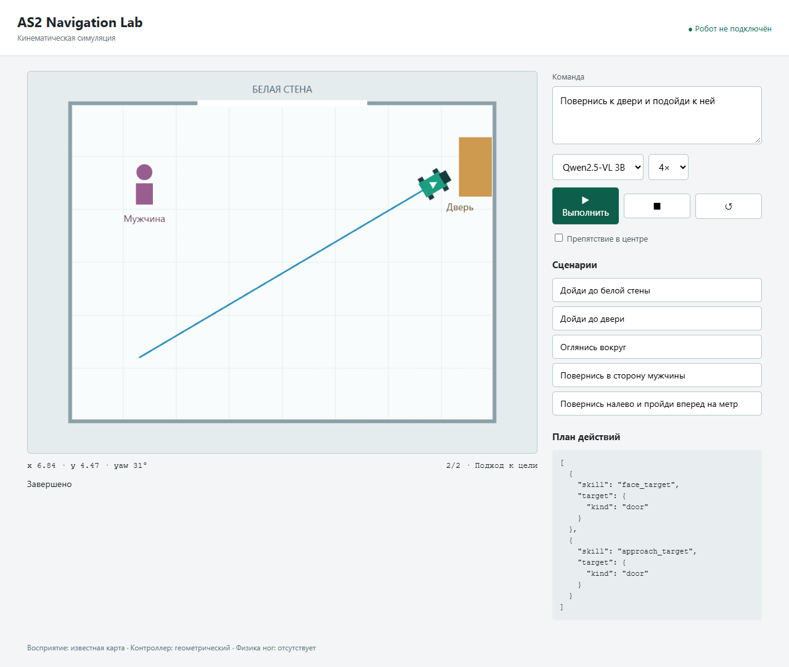

# AS2-VLM

A local-first prototype for language-guided navigation on the **Unitree AS2 EDU** quadruped. A compact vision-language model translates human instructions into validated action plans, while navigation and motion execution remain separate responsibilities.

Inspired by [NaVILA](https://github.com/AnjieCheng/NaVILA), this project starts with a narrower scope: one or two actions such as turning, walking a specified distance, approaching a door, or looking around. It is an independent prototype, not a port or reproduction of NaVILA.

**Current status:** local language planning, experimental single-image grounding, and a browser-based 2D simulator work without a robot. Physical AS2 motion control, live sensors, SLAM, and autonomous navigation are not integrated yet.



## Features

- **Local inference:** Qwen2.5-VL 3B through Ollama, without a cloud API. The backend also accepts the separately installed 7B variant.
- **Validated plans:** strict JSON contracts, skill-specific arguments, and at most two actions per instruction.
- **Offline rules mode:** a deterministic parser for a limited set of Russian commands.
- **Interactive simulation:** a top-down room, target objects, optional obstacle, trajectory display, stop/reset controls, and adjustable playback speed.
- **Experimental visual grounding:** bounding-box proposals from PNG/JPEG input, including explicit absent and ambiguous target states.
- **Development tools:** unit and local HTTP tests, live model smoke checks, environment preflight checks, and model-server scripts.
- **Read-only SDK access:** a C++ AS2 state probe and the official state subscriber have been built and tested against AS2 through WSL2. See [SDK Notes](docs/sdk_notes.md) for the peer-scoped UDP firewall requirements; motion control is not integrated.

## Architecture

```text
Russian instruction
       |
       v
Qwen2.5-VL / deterministic parser
       |
       v
Validated action plan (1-2 steps)
       |
       +--> CLI: preview only; no physical execution
       |
       +--> Browser demo: known-map kinematic simulation

Optional image --> Qwen2.5-VL --> unverified target-box proposal
```

The simulator uses predefined target coordinates and an exactly known robot pose. Image grounding is a separate experimental CLI path and is not connected to navigation.

## Quick Start

### Python Setup

Use **Python 3.10 or newer**. From the repository root:

```bash
python -m venv .venv
```

Activate the environment:

```powershell
# Windows PowerShell
.\.venv\Scripts\Activate.ps1
```

```bash
# Linux / macOS
source .venv/bin/activate
```

Install in editable mode with optional image support:

```bash
python -m pip install -e ".[vision]"
```

Pillow is only needed for image input. The rules backend and simulator use the Python standard library. Run the demo from the source checkout; its HTML asset is not currently packaged for standalone wheel installation.

### Run Without a Model

```bash
python -m as2_vlm.demo
```

Open **http://127.0.0.1:8765/**, select **Rules / "Правила · без модели"**, choose a command, and press **Run / "Выполнить"**. The demo UI is currently in Russian.

The virtual robot moves directly toward targets and stops at obstacles or room boundaries; it does not search for alternative routes. Each command starts from the current pose, so earlier movement affects available clearance. Reset returns it to the initial position.

Use `python -m as2_vlm.demo --port 8766` if the default port is occupied. On Windows, `./demo.ps1` is an alternative launcher; set `AS2_VLM_PYTHON` to select an explicit interpreter.

### Enable Local Model Planning

Install [Ollama](https://ollama.com/) and start its server if it is not already running:

```bash
ollama serve
```

In another terminal:

```bash
ollama pull qwen2.5vl:3b
python -m as2_vlm --healthcheck
```

Select **Qwen2.5-VL 3B** in the demo to use real model inference for language planning. There is no silent fallback to the rules backend. Inference speed and memory requirements depend on the host hardware.

Optional portable Ollama setup and project-local server scripts are described in [Model Setup](docs/vlm_setup.md). Runtime binaries and weights are excluded from Git.

## Supported Commands

The current prompt and rules parser target **Russian instructions**. English commands and arbitrary paraphrases are not validated capabilities.

| Instruction | Meaning | Expected action |
| --- | --- | --- |
| `Дойди до белой стены` | Approach the white wall | `approach_target` |
| `Дойди до двери` | Approach the door | `approach_target` |
| `Повернись в сторону мужчины` | Turn toward the man | `face_target` |
| `Оглянись вокруг` | Look around | `look_around` |
| `Повернись направо и пройди вперед на метр` | Turn right, then walk one meter | `turn_relative`, `walk_distance` |
| `Остановись` | Stop | `stop` |

Relative walks are limited to 2 meters, and relative turns to +/- pi radians. Supported target kinds are wall, door, and person. Moving away from a target, obstacle climbing, and longer task sequences are not implemented.

### CLI Examples

```bash
# Model-generated plan
python -m as2_vlm --backend ollama "Повернись к двери и подойди к ней"

# Experimental grounding on a local image
python -m as2_vlm --backend ollama --image room.jpg "Дойди до белой стены"

# Rules-only planning
python -m as2_vlm "Оглянись вокруг"
```

Successful planning CLI output is always `PREVIEW_ONLY` with `executed: false`. It never sends motion commands to a robot.

### Read AS2 State

With the C++ probe built and the Ethernet/firewall setup complete (see [SDK Notes](docs/sdk_notes.md)):

```bash
python -m as2_vlm --robot-state --robot-interface eth1
python -m as2_vlm.demo --robot-state --robot-interface eth1
```

On Windows, `./run.ps1 --robot-state` and `./demo.ps1 -RobotState` select the configured Python automatically. The Windows bridge launches the probe through WSL Ubuntu-22.04; Linux runs it directly. Use `--wsl-distro` for a different WSL distribution.

The demo's separate AS2 state section reads a timestamped snapshot only when its refresh button is pressed. It shows the actual operating mode, speed level, and process state. It is not a continuous connection indicator or odometry stream. No hardware queries occur without the server's explicit `--robot-state` opt-in. Simulation controls remain unrelated to hardware; the stop button is **not** a physical emergency stop.

A separate, operator-invoked `as2_stop_only` utility is provided for network `StopMove` requests. It is not called by the application, is not an independent emergency stop, and has not been physically verified merely by building it. See [Physical Test Safety](docs/physical_test.md) before use. Unplugging Ethernet is not a verified stop mechanism.

An isolated `as2_forward_pulse` manual bench-test utility is also available. It requires explicit confirmation, checks state and a stop acknowledgement, and requests a small fixed forward-velocity pulse followed by best-effort stopping. One operator-approved test returned successful Move and StopMove acknowledgements; travel distance was not measured and physical behavior requires operator verification. It is **not** a validated locomotion controller or a guaranteed single step and must not be used without an independent operator-controlled stop. Neither tool is exposed through the demo or the language planner.

The separate `as2_walk_meter` test adds an odometry-based one-meter target, a 0.15 m/s speed cap, a 12-second time limit, and best-effort stop conditions for stale data, lack of progress, and motion deviations. Its read-only odometry preflight has passed on AS2. The latest operator-approved physical attempt reached approximately 0.969 m by odometry before stopping on lack of progress, with StopMove acknowledged and stationary telemetry afterward. A full one-meter traversal has not been verified. The vertical-speed guard was increased to 0.5 m/s at the operator's request; this is not a validated safety limit. Other guards remain enabled. This is not obstacle-aware navigation or a hard safety controller. See [Physical Test Safety](docs/physical_test.md) before use and [Resume the Project](docs/RESUME.md) for the saved setup, results, rebuild and restart instructions.

## Testing and Evaluation

```bash
python -m unittest discover -s tests -v
python -m as2_vlm.evaluate
python -m as2_vlm.preflight
```

The regression suite covers plan validation, parser behavior, local model transport, image preparation, and simulated motion. Simulator tests include two-action sequences, heading changes, stopping, collisions, and boundaries. Recognized primitive commands also receive an independent completeness check so a model plan that drops an action is rejected.

`evaluate` requires a running local model. It is an inference smoke check, not a benchmark of general language understanding or robot navigation: recorded examples overlap with the few-shot prompt. Optional image checks assess response structure and detection status, not bounding-box accuracy.

`preflight` checks the local environment without contacting a robot. An incomplete result is expected without the Linux SDK build prerequisites and does not establish hardware readiness.

## Safety and Limitations

- **Application motion disabled:** optional app hardware access only calls `SportClient.GetState`. Demo motion and stop controls affect simulation only. Separate manual test binaries can issue StopMove or a forward pulse and require the precautions above; they are not application backends.
- **No camera-driven navigation:** bounding boxes are unverified proposals. A reviewed output was visibly inaccurate; refined detection, tracking, calibration, and metric depth remain necessary.
- **No legged dynamics:** the demo models planar kinematics and a circular footprint, not balance, leg contacts, terrain, or obstacle traversal.
- **No live mapping or localization:** geometry and targets are hardcoded. Dynamic people and changed surroundings are not represented.
- **Local development services only:** the demo binds to `127.0.0.1`, and the model client accepts loopback HTTP endpoints only. Do not expose these services publicly.

The simulator's 0.65-meter target standoff is a demo parameter, not a validated physical safety distance. Future control conventions are x forward, y left, and positive yaw left; a hardware adapter must verify and transform them for AS2.

## Roadmap

1. Verify AS2 firmware, onboard Linux environment, SDK access, and sensor streams.
2. Integrate read-only telemetry, calibrated sensors, and a tested motion adapter with explicit safety controls.
3. Build and save a LiDAR map, then localize against it while updating nearby obstacles from live sensors.
4. Add semantic annotations for named walls, doors, and rooms.
5. Connect validated language goals to a navigation planner and controller, keeping VLM inference outside the continuous control loop.
6. Evaluate unseen instructions and real AS2 camera data before physical navigation trials.

These are planned steps, not implemented features.

## Repository Layout

```text
as2_vlm/              Planning, validation, grounding, CLI, and simulator
configs/              Example configuration without device credentials
deploy/               Model runtime and environment helper scripts
docs/                 Setup, hardware notes, and development history
reports/              Recorded smoke results and simulation screenshots
robot/bridge_cpp/     Hardware-tested read-only AS2 SDK probe source
tests/                Unit and local HTTP regression tests
TECH_PLAN_AS2_VLM.md  Original technical implementation plan
```

Further reading: [Technical Plan](TECH_PLAN_AS2_VLM.md), [Simulator Notes](docs/simulator.md), [SDK Notes](docs/sdk_notes.md), and [Hardware Inventory](docs/hardware_inventory.md). Supporting documents are currently mostly in Russian; progress notes include historical development stages.
